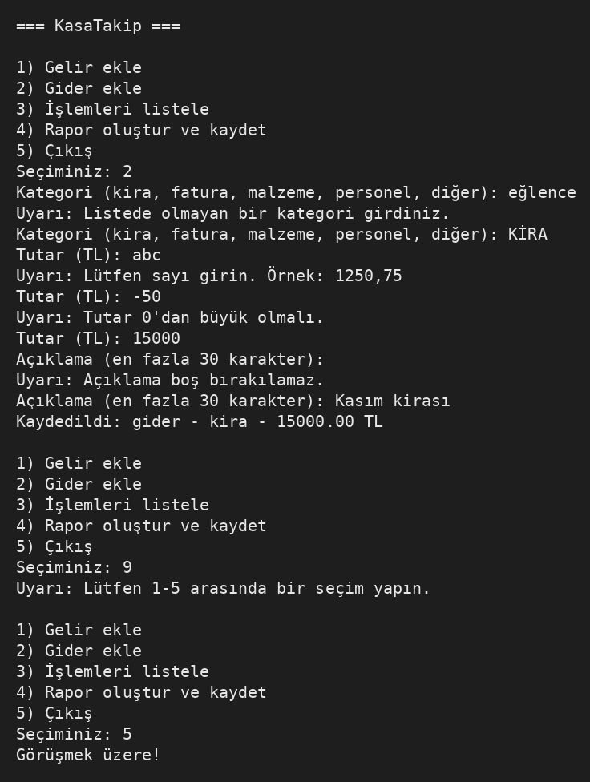

# KasaTakip – Küçük İşletme Gelir-Gider Takip Sistemi

Küçük bir işletmenin günlük gelir ve giderlerini kaydeden, özet rapor hazırlayan
komut satırı uygulaması. Elle tutulan kasa defterinin yerini alır.

## Ne yapar?
- Gelir (satış, hizmet, diğer) ve gider (kira, fatura, malzeme, personel, diğer) kategori, tutar ve kısa açıklamayla kaydeder.
- Hatalı girişte çökmez, uyarı verip tekrar sorar (harf, 0, negatif, `nan`, listede olmayan kategori, boş veya çok uzun açıklama). Ctrl+C ile çıkışta da hata vermez.
- Toplam gelir, toplam gider ve bakiyeyi hesaplar; giderlerin kategorilere göre dağılımını ve en yüksek gider kalemini gösterir.
- Raporu ekrana yazar ve iki dosyaya kaydeder:
  - `kasa_raporu_YYYY-AA-GG.txt` – özet rapor
  - `islemler_YYYY-AA-GG.csv` – tüm işlemler (Excel ile açılabilir)

## Nasıl çalıştırılır?
Python 3.8 veya üstü yeterlidir, ek kütüphane gerekmez. (Mac'te `python3`, Windows'ta `python` veya `py` yazın.)

```bash
python kasatakip.py
```

Menüden seçim yapın:
```
1) Gelir ekle
2) Gider ekle
3) İşlemleri listele
4) Rapor oluştur ve kaydet
5) Çıkış
```
Tutarlarda virgül de kullanılabilir (örnek: `1250,75`).

## Testler
```bash
python test_kasatakip.py
```
14 senaryo (9'u hatalı/uç girdi) programı gerçekten çalıştırır ve sonucu beklenen değerle karşılaştırır. Son çalıştırmada 14/14 test geçti.

**Test tablosu** (gerçek sonuçlar `test_kasatakip.py` çalıştırılarak alındı):

| # | Girdi | Beklenen sonuç | Gerçek sonuç | Durum |
|---|---|---|---|---|
| 1 | Normal: gelir 5000, kira 2000, fatura 500 | Gelir 5000.00; gider 2500.00; bakiye 2500.00; 2 dosya | Gelir 5000.00; gider 2500.00; bakiye 2500.00; 2 dosya | ✅ Geçti |
| 2 | Virgüllü tutar: 1250,75 | Uyarı yok; gelir 1250.75 | 0 uyarı; gelir 1250.75 | ✅ Geçti |
| 3 | HATALI: tutar yerine abc | 1 uyarı, çökmez; sonra 100 kabul | 1 uyarı; 100.00 kaydedildi | ✅ Geçti |
| 4 | UÇ: tutar 0 ve -50 | 2 uyarı; 300 kabul | 2 uyarı; 300.00 kaydedildi | ✅ Geçti |
| 5 | UÇ: tutar nan ve inf | 2 uyarı; 200 kabul | 2 uyarı; 200.00 kaydedildi | ✅ Geçti |
| 6 | HATALI: gider için 'satış' kategorisi | 1 uyarı; 'kira' kabul | 1 uyarı; 'kira' kabul edildi | ✅ Geçti |
| 7 | Türkçe büyük harf: KİRA | Uyarı yok; 'kira' olarak tanınır | 0 uyarı; 'kira' olarak tanındı | ✅ Geçti |
| 8 | UÇ: açıklama boş ve 31 karakter | 2 uyarı; 'Satış' kabul | 2 uyarı; açıklama kabul edildi | ✅ Geçti |
| 9 | Aynı kategori iki kez: kira 1000 + 500 | Dağılımda tek satır: kira 1500.00 (%100.0) | kira 1500.00 (%100.0); en yüksek kalem kira | ✅ Geçti |
| 10 | Zarar: gelir 1000, gider 3000 | Bakiye -2000.00; 'Zarar var' | Bakiye -2000.00; 'Zarar var' yazdı | ✅ Geçti |
| 11 | UÇ: gelir 0,3; gider 0,1 + 0,2 | Bakiye 0.00; 'Gelir ve gider eşit' | Bakiye 0.00; 'eşit' yazdı | ✅ Geçti |
| 12 | HATALI: işlem girmeden rapor | 1 uyarı; dosya oluşmaz | 1 uyarı; 0 dosya | ✅ Geçti |
| 13 | HATALI: menü seçimi 9 | 1 uyarı; menü tekrar gelir | 1 uyarı; menü tekrar geldi | ✅ Geçti |
| 14 | UÇ: girdi yarıda kesilir (Ctrl+D) | Hata dökmeden 'Program kapatıldı' | 'Program kapatıldı' yazdı | ✅ Geçti |

## Süreç raporu ve beyan formu
2–3 sayfalık süreç raporu bu depodadır: problem ve kullanıcı, sözde kod, yapay zekâ ile çalışma günlüğü, test tablosu ve en zor hata, yansıtma, **Yapay Zekâ Kullanım Beyan Formu** ve APA 7 kaynakça.

- [Raporu aç (PDF)](GEP1316_Odev1_MehmetSaitVarol.pdf)

## Ekran görüntüleri
Hatalı girdilerde uyarı:



Rapor ve dosyaya kayıt:


## Dosyalar
| Dosya | Açıklama |
|---|---|
| `kasatakip.py` | Uygulama |
| `test_kasatakip.py` | Test senaryoları |
| `PROMPTLAR.md` | Yapay zekâ ile çalışma günlüğü |
| `GEP1316_Odev1_MehmetSaitVarol.pdf` | Süreç raporu ve beyan formu |
| `ekran_goruntuleri/` | Ekran görüntüleri |

## Yapay zekâ kullanımı
Bu proje Claude (Anthropic) yardımıyla geliştirildi; süreç `PROMPTLAR.md` dosyasında belgelendi.
Anthropic. (2026). *Claude* [Büyük dil modeli]. https://claude.ai

Mehmet Sait Varol – GEP1316 Kodlama Okuryazarlığı, 2026-2027 Güz
