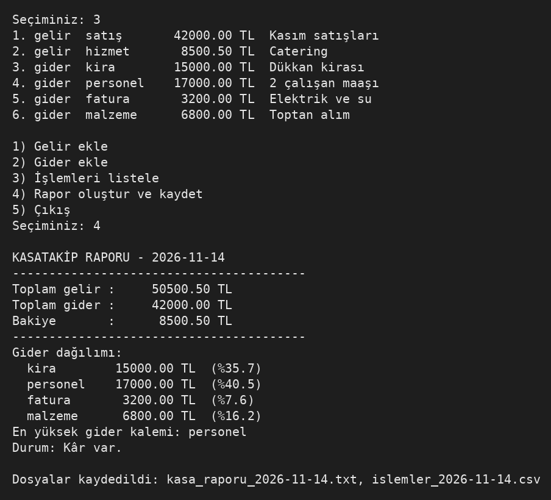

# KasaTakip – Küçük İşletme Gelir-Gider Takip Sistemi

Küçük bir işletmenin günlük gelir ve giderlerini kaydeden, özet rapor hazırlayan
komut satırı uygulaması. Elle tutulan kasa defterinin yerini alır.

## Ne yapar?
- Gelir (satış, hizmet, diğer) ve gider (kira, fatura, malzeme, personel, diğer) kategori, tutar ve kısa açıklamayla kaydeder.
- Hatalı girişte çökmez, uyarı verip tekrar sorar (harf, 0, negatif, `nan`, listede olmayan kategori, boş veya çok uzun açıklama). Ctrl+C ile çıkışta da hata vermez.
- Toplam gelir, toplam gider ve bakiyeyi hesaplar; giderlerin kategorilere göre dağılımını ve en yüksek gider kalemini gösterir.
- Raporu ekrana yazar ve iki dosyaya kaydeder:
  - `kasa_raporu_YYYY-AA-GG.txt` – özet rapor
  - `islemler_YYYY-AA-GG.csv` – tüm işlemler (Excel ile açılabilir)

## Nasıl çalıştırılır?
Python 3.8 veya üstü yeterlidir, ek kütüphane gerekmez. (Mac'te `python3`, Windows'ta `python` veya `py` yazın.)

```bash
python kasatakip.py
```

Menüden seçim yapın:
```
1) Gelir ekle
2) Gider ekle
3) İşlemleri listele
4) Rapor oluştur ve kaydet
5) Çıkış
```
Tutarlarda virgül de kullanılabilir (örnek: `1250,75`).

## Testler
```bash
python test_kasatakip.py
```
14 senaryo (9'u hatalı/uç girdi) programı gerçekten çalıştırır ve sonucu beklenen değerle karşılaştırır. Son çalıştırmada 14/14 test geçti.

## Ekran görüntüleri
Hatalı girdilerde uyarı:


Rapor ve dosyaya kayıt:



## Dosyalar
| Dosya | Açıklama |
|---|---|
| `kasatakip.py` | Uygulama |
| `test_kasatakip.py` | Test senaryoları |
| `PROMPTLAR.md` | Yapay zekâ ile çalışma günlüğü |
| `ekran_goruntuleri/` | Ekran görüntüleri |

## Yapay zekâ kullanımı
Bu proje Claude (Anthropic) yardımıyla geliştirildi; süreç `PROMPTLAR.md` dosyasında belgelendi.
Anthropic. (2026). *Claude* [Büyük dil modeli]. https://claude.ai

Mehmet Sait Varol – GEP1316 Kodlama Okuryazarlığı, 2026-2027 Güz
